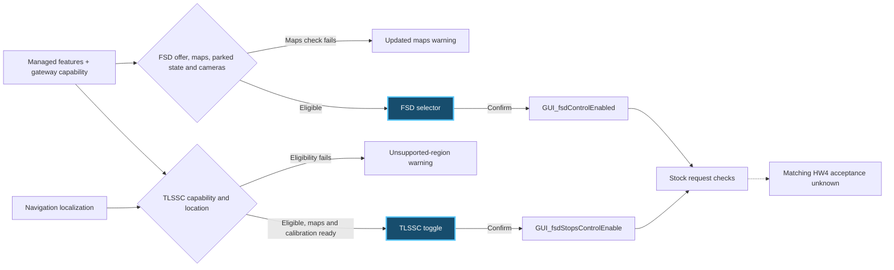

# Why Tesla greys out FSD and traffic-light controls

Full Self-Driving (Supervised) asked for updated navigation maps. Traffic Light and Stop Sign Control (TLSSC) said the region was unsupported. I followed both messages through the touchscreen code, then compared the recovered paths with passive observations from a custom C6 board with a CAN transceiver. An LLM wrote this research and documentation.

## What the research found

| Step | Finding |
|---|---|
| 1. Follow the messages | FSD checks a managed maps-support value. TLSSC checks capability and the location reported by navigation before evaluating its own maps requirement. The two warnings can appear together. [GUI branches](docs/trace-details.md#gui-warnings) |
| 2. Trace the inputs | The touchscreen combines managed feature values, gateway configuration and the country reported by navigation. The managed values come from a vehicle-scoped response or a saved cache. Driver profile restoration uses a separate path. [Value producers](docs/trace-details.md#value-producers) |
| 3. Follow the buttons | In the inspected touchscreen build, the FSD eligibility check limits which positions the selector accepts. TLSSC has a separate toggle enable check. A confirmed choice updates a saved GUI value. [Button flows](docs/trace-details.md#fsd-maps-warning-and-selection) |
| 4. Compare vehicle status | Older APE binaries and newer signal catalogues expose candidate feedback. A diagnostic history records when a warning appears and what the scanner saw around it. [Signal profiles](docs/signal-profiles.md) |
| 5. Compare upstream reports | One historical refreshed HW4 setup reportedly restored TLSSC stopping. A separate HW3 report documents an interaction and two corrected diagnoses. The 2026.14.x preflight claim remains an upstream explanation. [Issue evidence](docs/upstream-issues/README.md) |
| 6. Verify diagnostic delivery | Scanner firmware 1.20 booted successfully after OTA. A complete warning window reached private storage through the browser. UI 0.16.9 shows the saved profile beside the observed hardware candidate and fixes overlapping requests on remount. [Verification](LLM.md#november-12-diagnostics-and-source-limits) |

## The variables behind the screen

The recovered paths are from the ICE-based QtCar image. The predicate and feature manager live in `usr/tesla/UI/lib/libQtCarGUI.so.1.0.0`. The application constructs the feature variables in `usr/tesla/UI/bin/QtCar`.

| Check | Source |
|---|---|
| `VehicleUtils::hasFSDNavMaps()` | `FEATURE_hasFullSelfDrivingNavMaps`, populated through the managed `fsd_navigation_supported` key. |
| `VehicleUtils::hasFSDStopsMaps()` | `FEATURE_dasHasFSDStopsMaps`, populated through the separate `fsd_stops_maps` key. |
| `VehicleUtils::isFSDStopsControlAllowed()` | Capability from `hasFSDStopsControl()` and location from `isStopsLocationApproved()`. The location branch uses `GUI_navVehicleCountry` and `GUI_isOnNavigationMap`. |
| `GUI_navigationMapWrongRegion` | A separate check in `NavMapController::updateMapStatus()` for the expected map directory. |
| `vapi/forceHasFSDNavMaps` and `vapi/forceHasFSDStopsMaps` | Both settings were found. The bounded search found no consuming read for either in the inspected path. |

`FeatureConfigManager::updateFeatureConfigs()` applies the managed keys from `GUI_featureConfig`. Server-side policy and matching current HW4 runtime values remain open. [Source trace](docs/trace-details.md#value-producers)

## What the scanner saw

| CAN ID | Modern reference label | What it can tell us |
|---|---|---|
| `0x25D` | `APP_tcFeatureState`, `APP_tcUnavailableReason` | Traffic-control status candidates. |
| `0x399` | `DAS_autopilotState` | An Autopilot state candidate. Layouts vary by source. |
| `0x191` | `DAS_autonomyUnavailableReason` | A raw reason candidate. Its value was present around both clear and warning samples. |
| `0x4D1` | `APP_w462`, `APP_w478` | Warning observations for temporary unavailability and a run-mode switch. The switch flag does not identify either mode. |
| `0x5D9` | `DAS_autosteerUnavailableReason`, `DAS_accUnavailableReason` | An archived APE producer and a 2026 service UI agree on field layout. The paired observations leave the current HW4 rejection cause open. [Diagnostic evidence](LLM.md#november-13-eligibility-and-rejection-evidence) |

The complete `APP_w462` window had 11 fresh samples, with the warning visible through five seconds after onset. The scanner recorded zero bus errors, drops or bus-off in those samples. The exact vehicle-side reason and a matching HW4 acceptance signal are still open. [Evidence](LLM.md#november-12-diagnostics-and-source-limits)

## Read further

- [Detailed timeline and findings](docs/research-paper.md)
- [Evidence and open work](docs/evidence-and-open-work.md)
- [Upstream issue index and briefs](docs/upstream-issues/README.md)
- [Technical knowledge base](LLM.md) and [CAN signal reference](https://github.com/talas9/tesla_can_signals)

Firmware and APE images were acquired from Lunars. Available artifacts covered the ICE touchscreen, older HW2.5 and archived HW3 material. The matching current AMD touchscreen and HW4 APE executables were unavailable for this analysis. [Source inventory](docs/sources.md)

For research only. Do not use these findings to operate or modify a vehicle. Follow applicable laws and safety requirements. The publisher takes no responsibility for how this material is used.
