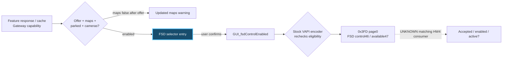
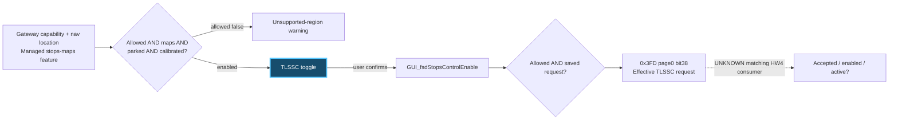

# FSD region gates, CAN requests and vehicle feedback

This research and its documentation were written entirely by an LLM, using firmware analysis, code inspection and recorded tests. Findings are linked to evidence; unresolved interpretations are marked.

I started with two messages: FSD asked for updated navigation maps, while Traffic Light and Stop Sign Control (TLSSC) said the region was unsupported. I wanted to find what decides those messages, what pressing the switches sends, and whether a modified request produces an independent response from the vehicle.

I used a custom C6 board with a CAN transceiver, disassembly and REA-assisted analysis. **I recovered useful source paths, but I have not proved that the HW4 test platform accepts the modified requests.**

## What I tried and learned

| Step | What I did | What I found |
|---|---|---|
| 1. Start at the screen | I followed the warning text into the GUI functions. | The maps warning and region warning use different checks. The maps message alone does not prove a map download would fix the restriction. [GUI trace](docs/trace-details.md#gui-warnings) |
| 2. Follow the inputs | I traced the values behind those checks. | Gateway country/map region, managed feature values and navigation-derived country are separate inputs. Managed values can also come from a saved cache. [Value producers](docs/trace-details.md#value-producers) |
| 3. Follow a button press | I followed confirmation through saved settings and request encoding. | The stock encoder checks eligibility again. A saved selection is not proof the vehicle accepted it. [Request path](docs/trace-details.md#requests-and-transport) |
| 4. Check ForceFSD | I compared the modifier with the upstream handlers. | Assist is different from selecting FSD in the GUI. Its predicate has no HW4 exclusion; unlock has separate hardware branches. Restore can do nothing when its input already matches. [Sources and qualifications](docs/sources.md#inspected-upstream-source) |
| 5. Find a receiver | I traced the available older APE request through shared memory into state-machine reads. | The older TLSSC request reaches a real consumer, with additional conditions. This is HW2.5 evidence, not current HW4 proof. [Older APE chain](docs/trace-details.md#older-ape-chain) |
| 6. Find independent feedback | I recovered older emitters and compared modern signal definitions. | IDs, field widths and meanings differ across sources. I kept those profiles separate. [Signal profiles](docs/signal-profiles.md) |
| 7. Compare stationary phases | I tested engine OFF→ON→OFF and isolated features. | The measured feedback candidates showed no reversible change establishing acceptance. Successful board submissions/completions are not an ECU acknowledgement. [Experiments](docs/experiments.md) |
| 8. Check visualization and recovery | I observed parked visualization, then attempted a further feature sweep. | The request stayed stable in the parked window. A later connection loss stopped the sweep; guarded recovery restored the original settings. Driving flicker and remaining cases are unresolved. [Observations and recovery](docs/experiments.md#stationary-visualization) |
| Separate tooling milestone | I prepared passive diagnostics and a journal of actual submitted transmissions. | Tests, builds and review passed. These changes are **not deployed**, so they provide no new on-vehicle acceptance result. [Implementation state](docs/evidence-and-open-work.md#implementation-state) |

## What decides the warnings

The starting clues were two stock settings: `vapi/forceHasFSDNavMaps` and `vapi/forceHasFSDStopsMaps`. Both exist, but their names were misleading leads: the inspected objects default to false, and the bounded search found no consuming reads. The actual map checks read managed feature variables instead.

This chain lives in the inspected **QtCar UI application**, not in the custom CAN board. The predicates and `FeatureConfigManager` are in `usr/tesla/UI/lib/libQtCarGUI.so.1.0.0`; the primary feature variables are constructed in `usr/tesla/UI/bin/QtCar`. These are generic installed paths in the inspected ICE image, not a claim about matching HW4 code.

| Screen check or input | Exact code / variable | What controls it |
|---|---|---|
| FSD maps check | `VehicleUtils::hasFSDNavMaps()` → `FEATURE_hasFullSelfDrivingNavMaps` | Managed key `fsd_navigation_supported`, subject to the registered hardware/default/factory update rules. |
| TLSSC maps check | `VehicleUtils::hasFSDStopsMaps()` → `FEATURE_dasHasFSDStopsMaps` | Separate managed key `fsd_stops_maps`; this is not the FSD navigation flag. |
| Managed feature values | `GUI_featureConfig` → `FeatureConfigManager::updateFeatureConfigs()` | `mothershipResponse()` parses a successful feature-configuration response. Persisted values can also be restored at startup. Missing/invalid target keys fall back to false; the backend decision algorithm is outside this client. |
| FSD control capability | `VehicleUtils::hasFSDControl()`; `FEATURE_fullSelfDriving` | The managed `full_self_driving` key is one input alongside hardware, configured country and Autopilot capability. It does not replace the maps check. |
| TLSSC regional eligibility | `VehicleUtils::isFSDStopsControlAllowed()` | Requires **both** `hasFSDStopsControl()` and `isStopsLocationApproved()`. Capability includes configured-country, hardware, package and legacy-DCAS checks; location is checked separately. |
| Where the car is localized | `GUI_navVehicleCountry`, `GUI_isOnNavigationMap` | Navigation-derived country must be valid, on-map and in an approved group. This differs from gateway-configured `VAPI_countryCode`. |
| Installed map-region check | `GUI_navigationMapWrongRegion` | `NavMapController::updateMapStatus()` checks the expected region's map directory after validity/mount guards. This flag is separate from the two managed maps-support flags. |

The [per-button traces](docs/trace-details.md#fsd-maps-warning-and-selection) follow these inputs backward and each confirmed request forward.

That is why downloading maps, changing a country value and forcing a CAN request are not interchangeable fixes. The main FSD entry also checks parked state and camera hardware. The TLSSC warning checks eligibility/region before maps, parked state and calibration. [Recovered branches and inputs](docs/trace-details.md#gui-warnings).

There are genuine stock force consumers too: `vapi/forceHasFSDControl`, `vapi/forceDisableFSDControl` and `vapi/force_fsd_autopilot`. They are distinct from the board's ForceFSD option. In the inspected `libQtCarUtils.so.1.0.0` loader, their environment value selects current/default values rather than normal settings-file loading. Other loader environments can read settings, but the `/var/run/is-fused` marker blocks that path for the inspected environment values 1 and 4. Finding a key therefore does **not** establish a working file override. [Force/configuration boundary](docs/trace-details.md#value-producers).

The matching HW4 implementation, actual runtime inputs and server-side feature policy remain unverified.

## Follow either switch

**FSD maps warning and selection** — the maps flag is only one gate. [Full eligibility and action trace](docs/trace-details.md#fsd-maps-warning-and-selection).

**TLSSC region warning and toggle** — configured capability and navigation localization are separate checks. [Full eligibility, clearing and action trace](docs/trace-details.md#tlssc-region-warning-and-toggle).

These summarize the ordinary UI paths; the detailed traces retain force/default/fuse branches, warning precedence and cruise behavior. Clicking or painting a selection is not engaging vehicle control. The board adds modified frames without replacing originals, so unchanged captured RX does not establish what it transmitted or whether the vehicle accepted it.

## Main messages I followed

These are selected **modern reference names**, not a validated HW4 decoder or a list of acknowledgements. Exact hardware applicability remains open. Bit positions and additional fields are discussed in the [profile notes](docs/signal-profiles.md); no raw captures or bulk signal database are published here.

| CAN ID | Signal names | Why I followed it |
|---|---|---|
| `0x3FD` | `UI_fsdStopsControlEnabled`, `UI_fsdVisualizationEnabled` | Outgoing TLSSC and visualization requests; neither is independent feedback. |
| `0x25D` | `APP_tcFeatureState`, `APP_tcStateMachine`, `APP_tcUnavailableReason` | Traffic-control status candidates. This is distinct from general APP status below. |
| `0x399` | `DAS_autopilotState`, `DAS_autopilotHandsOnState` | Operational state candidates; older state mappings differ. |
| `0x247` | `DAS_autopilotAbortReason`, `DAS_mapAvailability`, `DAS_rqstedBehaviorStatus` | Diagnostic conditions; behavior validity is not a generic request ACK. |
| `0x259` | `APP_fsdSuspendState`, `APP_autonomySystemHealth`, `APP_summonUnavailableReason` | General health, suspension and availability context. |
| `0x24A` | `DAS_navAvailable`, `DAS_plannerState` | Navigation/planner context; navigation availability is not the managed FSD maps flag. |
| `0x191` | `DAS_autonomyUnavailableReason` | A diagnostic reason candidate, not a proven explanation for the TLSSC gate. |

The selected inventory contains **55 IDs, 37 modern definitions and 2700 signals; 18 IDs lack modern definitions**. Verification and independent review passed. Separately, the older APE registry has 52 entries covering 48 unique IDs. These are potential emissions, not proof every message appears on the current platform.

## Important corrections

- I cannot treat the older `0x3EE` receiver as proof of the modern `0x3FD` path.
- I cannot equate request accepted, feature enabled and control active.
- I cannot turn an upstream version-specific failure report into a universal HW4 claim.
- I cannot infer lossless capture from flat physical bus counters. The interrupted harness omitted unsubscribed DROP notifications; heartbeat, bus, error and fault notifications were always delivered.
- I cannot attribute the connection interruption to LaneGraph or explain driving flicker from a stable parked test.

[Correction log](docs/corrections.md) · [Methodology](docs/methodology.md)

## Source limits and what remains

Firmware and APE images acquired from Lunars. These were the latest images I could obtain; no MCU3/HW4 images or newer HW3/HW2.5 APE images were available to me. This is my availability report, not an independent audit of available firmware.

The inspected MCU source is ICE-based; the inspected APE source is older HW2.5. The live platform is HW4, and a historical HW3 symptom is recorded separately. I have not completed a paired HW3/HW4 comparison.

My main open task is to connect a **matching HW4 request receiver to an independent accepted/enabled indication**. The backend policy, full GUI writer lifecycle, visualization consumers and remaining feature combinations also have open edges. I have indexed them rather than treating them as finished.

- [Complete research paper and hardware matrix](docs/research-paper.md)
- [Every route and its remaining boundary](docs/route-index.md)
- [Evidence and next work](docs/evidence-and-open-work.md)
- [Public source references](docs/sources.md)
- [Structured sanitized findings](findings.json)

This repository contains independent research notes. It excludes identifying vehicle information, raw captures, firmware binaries, decompilation dumps and bulk signal databases. The issue comment remains a separate private draft. Source copyrights and licenses remain with their holders; a publication license for these notes has not been selected.

Research purposes only. Do not act on these findings or use them to modify or operate a vehicle. The authors accept no responsibility for how this information is used. Do not use it for unlawful activities.
