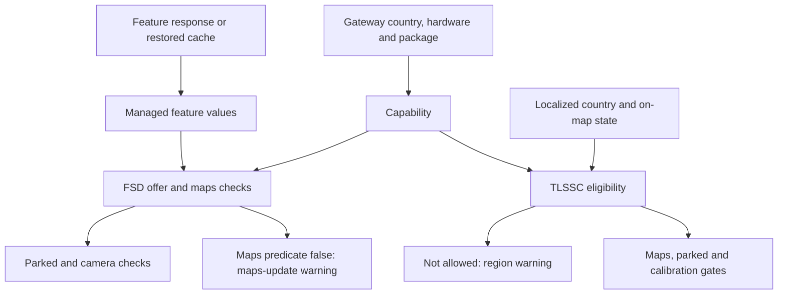
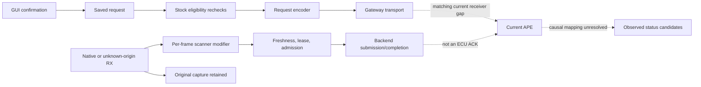

# Research paper: region gates, requests and feedback

Working record; partial investigation. **Recovered source behavior, candidate layouts, current-car observations and upstream reports are kept separate.** “Request accepted,” “feature enabled” and “control active” are different outcomes.

## How I got here

I began with the GUI because the messages seemed to point to different problems. By following their string references and disassembling the surrounding functions, I found separate checks behind the maps warning and the region warning. I then traced where those checks get their inputs, rather than assuming one server flag decides everything.

Next, I followed what happens when I press a switch. Confirmation saves a request, and the stock encoder checks eligibility again before sending it. Comparing this with the custom board and upstream code taught us that ForceFSD Assist is not the same action as selecting FSD in the GUI.

I then used REA-assisted analysis on the available older APE artifact. I followed a request through decoding, shared memory and actual state-machine reads. That closed an older internal path, while leaving the current HW4 receiver and its acknowledgement unresolved.

With that distinction in place, I collected stationary feedback and compared engine and feature phases. I did not find a request-correlated acceptance signal in the measured candidates. I built a submitted-TX journal and passive diagnostics to make future observations clearer; those changes have not been deployed. A later connection-loss abort also exposed a capture-notification limitation, which I documented and corrected without attributing the interruption to a feature.

The table below links each step to its detailed method, result and remaining gap.

## Timeline

| Milestone | Brief finding | Detailed evidence/method |
|---|---|---|
| Symptoms | Test platforms with region-dependent feature availability show region restrictions; the main FSD message asks for updated maps. | User screenshots/reported map swaps; [GUI details](trace-details.md#gui-warnings). |
| GUI trace | Main FSD maps warning and TLSSC region warning have different predicates. | String references and function disassembly in an inspected ICE-based source image; [gates](trace-details.md#gui-warnings). |
| Producer trace | Gateway country, map region, managed feature values and localized country are separate authorities. | Decoder/DataValue registrations, HTTP-response parser, persistence and map-match branches; [inputs](trace-details.md#value-producers). |
| Action trace | GUI confirmation writes saved requests; the stock encoder rechecks eligibility. | Callback/setter/encoder/transport analysis; [request path](trace-details.md#requests-and-transport). |
| Scanner comparison | ForceFSD Assist differs from selecting the GUI FSD mode; Restore can be a no-op. | Local handler review and raw target values; [upstream comparison](sources.md#inspected-upstream-source). |
| Older APE | A HW2.5 source artifact accepts an old TLSSC request and exposes state consumed by ASM. | Decoder→callback→shared-memory→selected snapshot→consumer chain; [older receiver](trace-details.md#older-ape-chain). |
| Signal inventory | Older registry has 52 entries/48 IDs; current selected modern set has 55 IDs/37 definitions/2700 signals. | Registry constructor/dispatcher analysis and profile-scoped extraction; [profiles](signal-profiles.md). |
| Engine comparison | OFF→ON→OFF showed no reversible stable-bit changes in the measured candidates. | Six filtered capture windows; [experiments](experiments.md#engine-off-on-off). |
| Isolated features | Visualization, LaneGraph and Assist interventions changed scanner behavior without stable receiver-candidate changes. | Eight filtered phases; [isolated experiment](experiments.md#isolated-features). |
| Stationary observation | Visualization bit 37 stayed 1 for 120 s; separate 0x25Dcandidate status decoded disabled. | Read-only cadence/status capture; [stationary observation](experiments.md#stationary-visualization). |
| Improved tools | Host CLI, actual-TX journal and passive diagnostics verified locally. | Reported tests/builds and review; [implementation](evidence-and-open-work.md#implementation-state). No deployment. |
| Interrupted sweep | Restore/Assist completed partial phases; later link loss aborted LaneGraph testing. Guarded recovery restored original settings. | Readback, freshness guard, reconnect/Stop/CAS/readback/Start evidence; [recovery](experiments.md#interrupted-follow-up-and-recovery). |

## GUI eligibility

This is a bounded ICE-based source branch summary, not a current-HW4 causal proof. The main warning does not, by itself, establish that a map download will solve the restriction. [Detailed gates and functions](trace-details.md#gui-warnings).

## Request and feedback boundaries

Original frames are retained. Modified requests are additive; successful backend submission/completion is not ECU acknowledgement. A new bounded journal will expose actual submitted payloads once deployed; pre-admission skips and ECU acceptance remain separate. [Workflow grid](trace-details.md#workflow-grid).

## Hardware and applicability matrix

| Population | Generalized identity | What it supports |
|---|---|---|
| Inspected CID | ICE-based source artifact | Recovered GUI/policy/request code in that source build. |
| Inspected APE | HW2.5 source artifact | Older request decoder/ASM/emitter chains. **Not HW3/HW4 proof.** |
| Primary live platform A | HW4 test platform | Stationary CAN/scanner observations in this investigation. |
| Historical platform B | HW3 test platform | Historical region-availability symptom only. |
| Future comparison | Separate HW3 platform | No paired comparison completed. |
| Comparative gateway | Nonmatching source artifact | Comparative routing only; prior target attribution was incorrect. |

Gateway hardware raw 5 remains an unresolved enum here; manual hardware selection is preserved. Matching current HW4 receiver/publisher evidence is still missing. The older and modern sources have different IDs, DLCs, widths and enums and remain separate profiles.

## Findings that changed the interpretation

- ForceFSD Assist is not the GUI FSD selection. The inspected upstream ForceFSD predicate has no HW4 exclusion; unlock handling has separate hardware branches.
- A version-specific upstream HW4 failure note is not a universal failure statement. Discussion reports are attributed observations/conclusions, not my independently proved current-car behavior.
- Old 0x3EE receiver evidence cannot silently establish modern 0x3FDbehavior.
- Modern traffic-control candidate status is 0x25D, not general APP status 0x259.
- A reported conflicting override configuration was rejected; it does not demonstrate a valid last-write-wins interaction.
- TX accepted/completed, a present message ID and a disabled candidate status are not request-correlated acceptance/rejection proofs.
- Stable parked visualization does not resolve reported driving flicker. A link-loss abort is not proof LaneGraph caused the failure.

[Exact upstream references](sources.md) · [open tasks](evidence-and-open-work.md#open-work)
