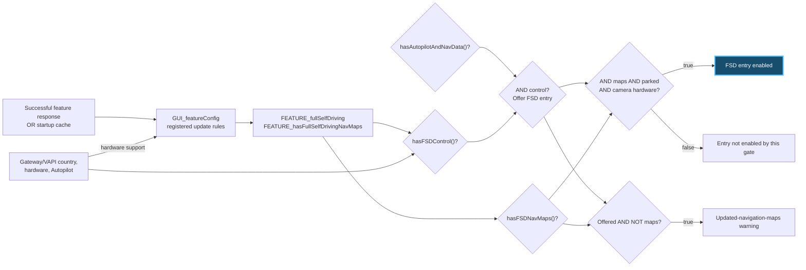
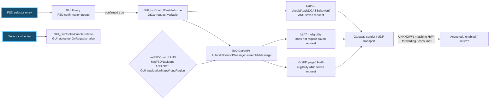
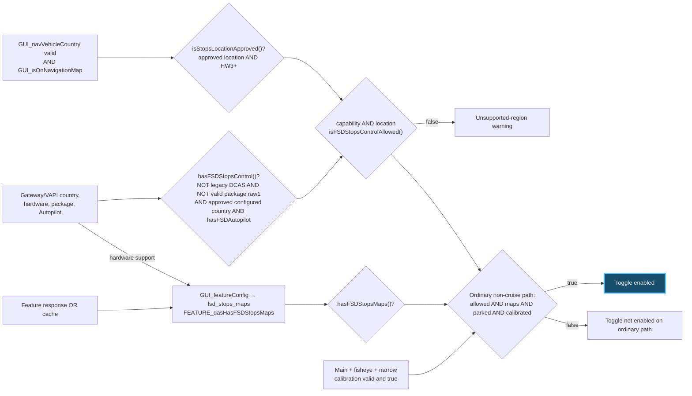
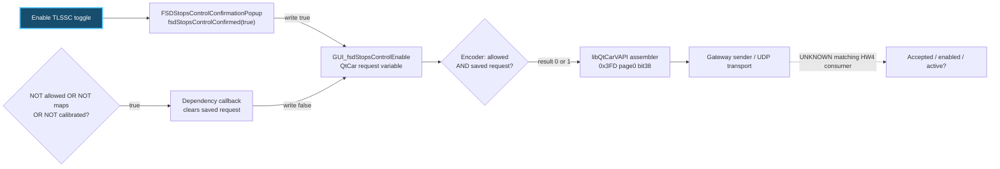
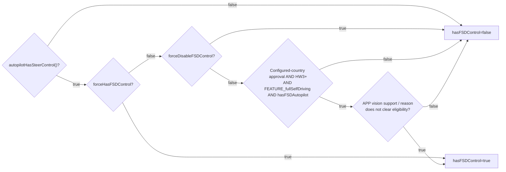
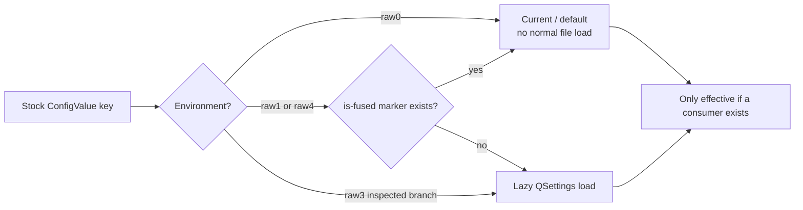

# Recovered trace details

## GUI warnings

Source: ICE-based CID artifact, `usr/tesla/UI/lib/libQtCarGUI.so.1.0.0`.

| Function or message | Recovered branch |
|---|---|
| `topLevelApFeaturesDependencyChanged` | FSD offer uses Autopilot/navigation and FSD-control capability. Enablement additionally checks parked state, FSD maps and cameras. |
| Main warning | “Full Self-Driving (Supervised) requires updated navigation maps. Connect to WiFi to download.” Selected by the maps-predicate branch. |
| `hasFSDNavMaps` | Reads `FEATURE_hasFullSelfDrivingNavMaps`. |
| `fsdStopsControlDependencyChanged` | Visibility, request clearing and toggle enablement are distinct. Warning precedence: eligibility/region, maps, parked, calibration. |
| TLSSC warning | “Traffic Light and Stop Sign Control is not supported in current region.” |
| `isFSDStopsControlAllowed` | Capability AND localized approval. |

The managed maps-support predicate does not establish that an installed package is outdated. The exact failed live-platform gate remains unresolved.

## Read the flows

Each button has two views below: **backward** to the values deciding availability, and **forward** from a confirmed action to the outgoing request. A diamond is a Boolean check, not an invitation to force it. Solid arrows are bounded recovered dependencies; a dashed UNKNOWN edge is an unproved receiver link. Neither a painted selection nor a saved request is evidence of vehicle engagement.

The containing application is `usr/tesla/UI/bin/QtCar`. UI callbacks, `VehicleUtils` predicates and `FeatureConfigManager` are in `usr/tesla/UI/lib/libQtCarGUI.so.1.0.0`; primary GUI/feature variables are constructed in QtCar. The request assembler/sender is in `usr/tesla/UI/lib/libQtCarVAPI.so.1.0.0`. Configuration loading is in `usr/tesla/UI/lib/libQtCarUtils.so.1.0.0`. These installed filenames describe the inspected ICE artifact, not matching HW4 firmware.

### FSD maps warning and selection

**Backward: why is the FSD entry offered, disabled or showing a maps warning?**

`hasFSDNavMaps()` directly returns `FEATURE_hasFullSelfDrivingNavMaps`, registered as `fsd_navigation_supported`. `hasFSDControl()` checks steering capability first, then its force-allow/force-deny branches, otherwise configured-country approval, HW3-or-higher, `FEATURE_fullSelfDriving` and `hasFSDAutopilot()`, with an additional vision-support reason branch. The two checks are not interchangeable.

`hasAutopilotAndNavData()` is `forceHasAutosteer OR (hasAutopilot() AND navigationDataAvailable())`. Its remaining nested capability leaves are not all closed. Camera eligibility returns false only for valid `APP_teslaVisionUnsupportedReason` raw2 in the inspected helper. Parked and camera checks decide whether the offered entry is usable; the maps message alone does not prove an outdated installed package.

The framework enforces the entry limit on touch. `canEnableFSDControl()` feeds `SlideSwitch::setNumLastEntriesDisabled()`, and `touchToPos()` clamps the position that `released()` submits. `updateTopLevelAPSelection()` separately reads the saved FSD and Autosteer requests to paint the selected position.

**Forward: what does selecting FSD actually write and send?**

The actual writer is `FSDConfirmationPopup::fsdConfirmed(bool)`. The selector's off branch clears `GUI_fsdControlEnabled` and `GUI_autosteerOnRequest`; its paint/update function reads saved values rather than acceptance. Other profile/reset/auto-enable writers also exist, so this is a confirmed-action path, not the whole variable lifecycle.

The encoder's eligibility above is `hasFullSelfDriving()`. Installed map-region validity enters through `GUI_navigationMapWrongRegion`, independently of the managed maps-support flag. Its NavMapController writer checks expected map folders after validity/mount guards; early returns can retain an earlier value. The stock bit60 equation and its configuration/fuse branches are documented [below](#stock-force-and-configuration-branches).

### TLSSC region warning and toggle

**Backward: why is the toggle unavailable, or showing a region warning?**

`hasFSDStopsControl()` rejects legacy-DCAS behavior and a valid feature-package raw1, otherwise requiring `isStopsApprovedCountryCode() AND hasFSDAutopilot()`. The country helper checks configured `VAPI_countryCode`/European-vehicle eligibility and hardware. `isStopsLocationApproved()` separately checks a navigation-localized approved group and HW3-or-higher: configured country and map-derived country are not the same source.

Warning precedence is **allowed/region → maps → parked → calibration**. Section visibility is separate. With an enabled request and cruise active, a different branch disables the toggle. The ordinary-path diamond is not every UI branch.

**Forward: what does confirmation write, and what can clear it again?**

The clearing edge writes **false** to the same variable. Parked state affects the toggle, but does not guard this invalidation write. The encoder's bit38 equation has no direct maps term: maps/calibration can clear the saved request upstream. Treating these as the same Boolean expression would hide that distinction.

The generic `ConfirmationSlideSwitch::confirmPosition(true)` in `libQtCarUIFramework.so.1.0.0` accepts the **current mapped position**; its true argument is not itself a forced-on value. The explicit popup confirmation writer above establishes the on path. Generic position/inversion/protected-write policy and other lifecycle writers retain open edges.

The available older HW2.5 receiver is a separate `0x3EE` path: bit38 → guarded accepted state → RoadRunner snapshot → ASM reads, with additional guards. It is useful receiver evidence, but it cannot fill the dashed modern-HW4 edge or establish a request ACK from a status change.

### Stock force and configuration branches

The original clues `vapi/forceHasFSDNavMaps` and `vapi/forceHasFSDStopsMaps` default false and have no consuming reads in the bounded inspected set. They must not be drawn as active overrides of the two maps predicates.

| Recovered branch | Exact relation and boundary |
|---|---|
| `hasFSDControl()` force checks | After steering-capability rejection: `vapi/forceHasFSDControl` returns true before `vapi/forceDisableFSDControl` can return false. Otherwise normal eligibility is evaluated. Both objects use environment raw0. |
| `hasFSDAutopilot()` | `vapi/force_fsd_autopilot` can allow it; otherwise requires valid `VAPI_autopilot` raw3. The force object uses raw0. |
| `shouldApplyDCASBehavior()` | Cached `vapi/enable_DCAS_behavior OR (NOT vapi/force_disable_DCAS_behavior AND FEATURE_enableEUFSDBehavior)`. Both settings default false; environments are raw3 and raw1 respectively. The managed feature's registration/key/policy remains unresolved. |
| ConfigValue environment raw0 | Returns current/default values without normal QSettings file loading. A name with “force” therefore does not prove file configurability. |
| Environment raw1/raw4 | The `/var/run/is-fused` marker skips QSettings loading when present; without it the inspected branch permits lazy file loading. This is not a claim about actual hardware fuse state. |
| Environment raw3 | The inspected loader reaches lazy QSettings loading without that raw1/raw4 fuse check. This does not establish that changing a file would change a running vehicle: values may be cached and other gates remain. |

The force-allow and force-deny order matters; both sit inside the capability predicate rather than replacing every later maps check:

The vision diamond retains its validity-sensitive branch: when `APP_teslaVisionSupported` is valid/raw1, unsupported-reason raw1 clears the hardware result; raw0 logs without clearing it. This is distinct from the camera helper's raw2 rejection. These are raw inspected branches, not a verified enum interpretation for another platform.

The marker is established by the inspected startup `is-fused` script chain; its hardware-query internals and actual target values are unverified. No force setting, file or fuse state was changed. These stock settings differ from the custom board's ForceFSD predicate.

## Value producers

| Input | Recovered source and boundary |
|---|---|
| Gateway configuration | Internal ETH `0x7FF` fields feed country, hardware, tier, package and map-region VAPI values through CRC-keyed DataValue registration. Physical routing and current hardware enums require separate evidence. |
| Managed features | `FeatureConfigManager` requests vehicle `feature_configuration` with hardware and Autopilot inputs from VAPI. The parser writes `GUI_featureConfig` and registered policies update feature values. Startup persistence can supply cached values. Server decision logic is outside the client. |
| Driver profile | `ProfileManager::downloadVault()` uses `AccountManagerUIClient` to fetch profile data. A separate guarded restore path updates the saved Autopilot selection. |
| Localized country | Navigation country and on-map state are distinct from gateway factory country. Map-match administrative country depends on installed map data. |
| Map region/wrong region | Folder, version, mount and suppression branches contribute; some early returns retain the previous flag. |
| Stock force settings | Consumer and environment/fuse checks are necessary. Two original force-map objects had no consuming reads in the inspected 15-ELF/30-object set; indirect uses and other builds remain open. |

## Requests and transport

FSD confirmation writes `GUI_fsdControlEnabled=true`; TLSSC confirmation writes `GUI_fsdStopsControlEnable=true`. The three-mode selector has separate off/Autosteer writers and does not simply set TLSSC.

The TLSSC callback passes visibility to `DisplayView::show()` and clickability to `DisplayView::enable()`. For the ordinary transition from off to on, eligibility, maps, parked state and calibration all matter. The already-enabled and active-cruise paths have separate handling.

VAPI `AutopilotControlMessage::assembleMessage` rechecks eligibility before assembling fields:

| Bit | Meaning in the inspected build |
|---|---|
| 38 | Effective TLSSC request. |
| 46 / 47 | FSD control / availability. |
| 60 | DCAS-related behavior. |

The CID sender packages a 10-byte UDP record: a big-endian 16-bit DLC/ID header and eight payload bytes. Matching HW4 forwarding and acceptance remain unresolved. These stock semantics alone do not establish that a handler for another hardware/version is wrong.

## Older APE chain

The older HW2.5 `0x3EE` decoder reads TLSSC bit 38, applies a receiver-state guard and writes accepted state into RoadRunnerSignals. ASM reads selected snapshot `+0x4dc`, with additional conditions from ArbiterTrajectoryOutput `+0xdf0` and RoadRunner `+0x104`.

Toggle loss produces internal reason 8, `STOPS_BUTTON_TOGGLE`, and conditional HOLD state. A published ASM Boolean at `+0x68` has no established CAN mapping; it is distinct from the `0x247` abort source at ASM `+0x84`. Separately, the older `0x399` emitter reads ASM/MissionPlanner state. Its enum is not automatically the modern `ACTIVE_FSD` mapping.

Visualization bit 37 updates on received requests and reaches a RoadRunner snapshot byte. This branch is not a boot-only latch. Downstream rendering, timeout behavior and HW4 consumers remain unresolved.

## Workflow grid

| Stage | Established | Missing link |
|---|---|---|
| GUI eligibility | Strings, callers and predicates. | Matching live code and failed runtime gate. |
| GUI action | Request setters and consumers. | Remaining profile/reset writers and invalidation paths. |
| Board modifier | Eligible-frame mutations; already-target Restore input is unchanged. | Receiver outcome. |
| Submission | Transport counters; new journal implemented locally. | ECU receipt/accepted state. |
| Older receiver | Request → shared state → ASM reads. | Modern `0x3FD` / HW4 equivalent. |
| Feedback | Older emitters and modern definitions. | Request-correlated accepted/enabled/activity mapping. |
